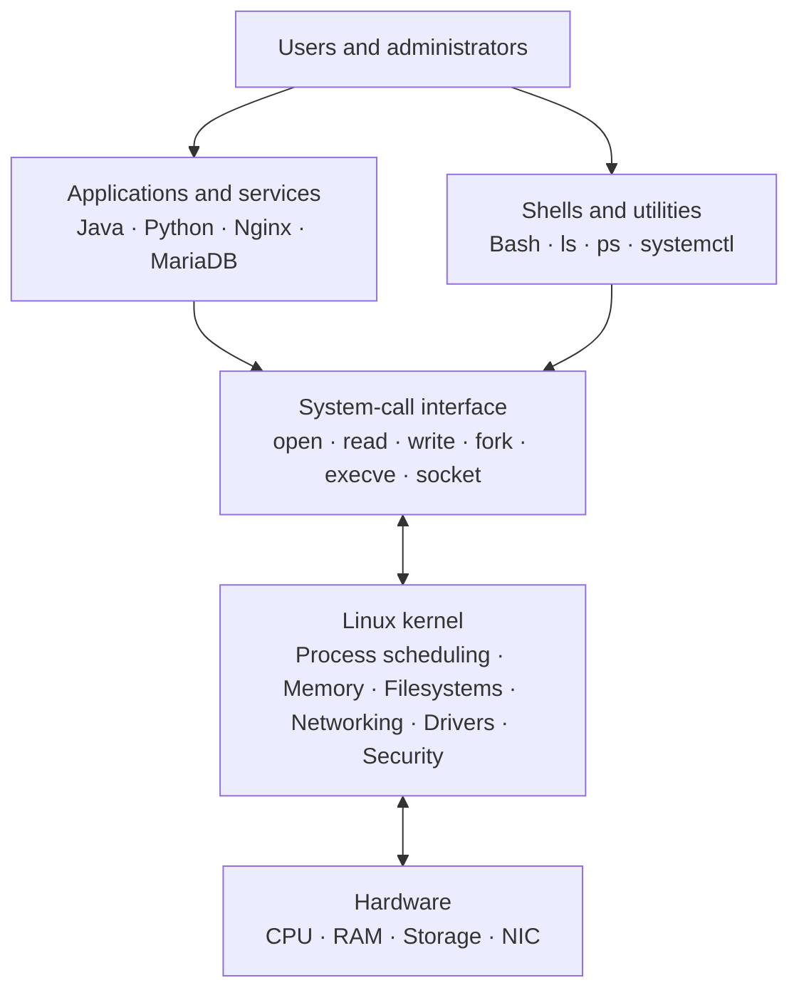

# Linux Fundamentals – Linux Architecture

## Learning objective
Understand the major Linux components, their responsibilities, and how applications use hardware through the operating system.

## What is Linux?
Linux is an open-source, Unix-like operating-system kernel. A Linux distribution combines the kernel with system libraries, utilities, package-management tools and other software. Examples include RHEL, CentOS, Rocky Linux, Ubuntu, Debian and Amazon Linux.

## Major components
1. **Hardware** – CPU, RAM, storage, network interfaces and other devices.
2. **Kernel** – manages system resources and controlled access to hardware.
3. **System-call interface** – allows user-space programs to request kernel services.
4. **User space** – shells, commands, libraries, services and applications.

## Architecture diagram

## Responsibilities

| Component | Responsibility | Examples |
|---|---|---|
| Hardware | Provides computing resources | CPU, RAM, disk, NIC |
| Kernel | Manages resources and access | Scheduling, memory, filesystems, networking |
| System-call interface | Lets programs request kernel services | `open()`, `read()`, `write()`, `fork()`, `execve()`, `socket()` |
| Shell | Interprets interactive commands and scripts | Bash, sh |
| System utilities | Common user/admin operations | `ls`, `ps`, `df`, `ip` |
| Libraries and runtimes | Reusable program functionality | glibc, Java runtime, Python runtime |
| Applications/services | Deliver business functionality | Java services, Nginx, MariaDB, RabbitMQ |

## Kernel space and user space
- **Kernel space** is the privileged execution area where the kernel runs.
- **User space** is where ordinary applications, shells and utilities run with restricted privileges.
- User-space programs request privileged operations through system calls rather than directly controlling hardware.

## Example: what happens when `ls -l /etc` runs?
1. Bash parses the command and starts the `ls` program.
2. `ls` requests directory information through operating-system interfaces.
3. The kernel performs filesystem operations and checks permissions.
4. The program formats the returned information.
5. The terminal displays the output.

## Production relevance
When a Java service becomes slow, investigate the relevant layers:
- Application: application logs, request processing and thread behavior.
- User space: process status and resource consumption.
- Kernel/resources: CPU scheduling, memory pressure, disk I/O and networking.
- Virtualization: if applicable, ask the infrastructure team to investigate host contention.

## Scope
This note introduces kernel responsibilities only at a high level. Detailed kernel internals, modules, boot process, systemd and kernel tuning will be covered later.
