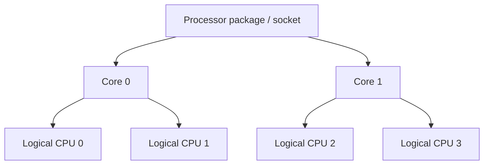

# Hardware Fundamentals – CPU Architecture

## Learning objective
Understand CPU, socket, core, hardware thread, logical CPU, cache and how CPU topology is presented to a virtual machine.
## 1. CPU
CPU means Central Processing Unit. It executes program instructions. The operating system schedules runnable tasks so they can use available logical processors.

## 2. Socket, core and hardware thread
- **Socket:** physical processor connection/package position on a motherboard.
- **Core:** an execution core inside a processor package.
- **Hardware thread:** an execution context exposed by a core using simultaneous multithreading (SMT), 
- **Logical CPU:** a schedulable processor context visible to Linux, often identified as CPU 0, CPU 1, etc.

### CPU topology diagram

This is an example of 1 socket, 2 cores and 2 hardware threads per core. It is not the topology of every processor.

## 3. CPU count calculation
For a conventional topology:

`Logical CPUs = Sockets × Cores per socket × Threads per core`

Example: 2 sockets × 8 cores per socket × 2 threads per core = 32 logical CPUs. The physical core count is 2 × 8 = 16.

Two hardware threads sharing one core do not provide the same resources as two independent physical cores.

## 4. Hardware threads vs software threads
- A **hardware thread** is an execution context exposed by a CPU core.
- A **software thread** is an execution unit created by an application/runtime and scheduled by the OS.

A Java application can create many software threads even when a VM has only a few logical CPUs. Those threads may run, wait or compete for CPU time.

## 5. CPU cache
CPU cache is small, fast memory close to CPU execution units. It reduces delays from fetching frequently used instructions and data from main memory.

## 8. Analysis of our supplied `lscpu` output

| Field | Observed value | Interpretation |
|---|---|---|
| Architecture | `x86_64` | 64-bit x86 architecture |
| CPU(s) | `4` | Four logical CPUs visible to Linux |
| Online CPU list | `0-3` | CPUs 0 through 3 are online |
| Threads per core | `1` | One exposed hardware thread per core |
| Cores per socket | `4` | Four cores per reported socket |
| Sockets | `1` | One socket in reported topology |
| NUMA nodes | `1` | One NUMA node reported |
| Model name | Intel Core i5-2320 @ 3.00GHz | CPU model string reported |
| L1d | `32K` | Reported L1 data cache |
| L1i | `32K` | Reported L1 instruction cache |
| L2 | `256K` | Reported L2 cache |
| L3 | `6144K` | Reported L3 cache (6 MiB) |

Calculation from the displayed topology:
- Reported cores: 1 socket × 4 cores = 4.
- Reported logical CPUs: 1 × 4 × 1 = 4.

The output is consistent with a four-core, four-thread i5-2320 topology.

### Virtualization observation
`systemd-detect-virt` returned `none`, and `lscpu | grep -i hypervisor` returned no output. These checks did not detect/report a recognized hypervisor; this is not conclusive proof that the machine is physical. Confirm with infrastructure inventory and, where appropriate, DMI information.

`Virtualization: VT-x` in `lscpu` indicates CPU hardware virtualization capability. It does not by itself mean Linux is running inside a VM.

## 9. Production relevance
When an application is slow:
1. Check load and CPU utilization.
2. Identify processes consuming CPU.
3. Compare workload with logical CPUs available to the OS.
4. Check memory and I/O; high load is not always CPU saturation.
5. If it is a VM and guest evidence does not explain the delay, ask the virtualization team to check host contention.

Do not conclude that a server needs more vCPUs from one CPU snapshot. Correlate metrics over the incident window.

## 10. Interview answer
A socket represents a processor package or socket presented to the system. Each package contains one or more cores. A core may expose one or more hardware threads through SMT. Linux sees these execution contexts as logical CPUs and schedules runnable tasks on them. For a conventional topology, logical CPU count is sockets multiplied by cores per socket multiplied by threads per core. In a VM, this describes the topology exposed to the guest and does not necessarily reveal the physical host topology.
